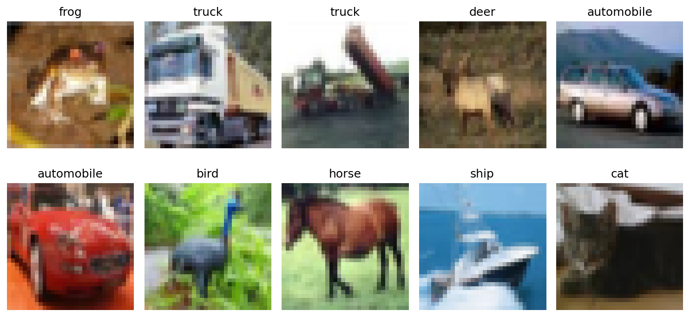
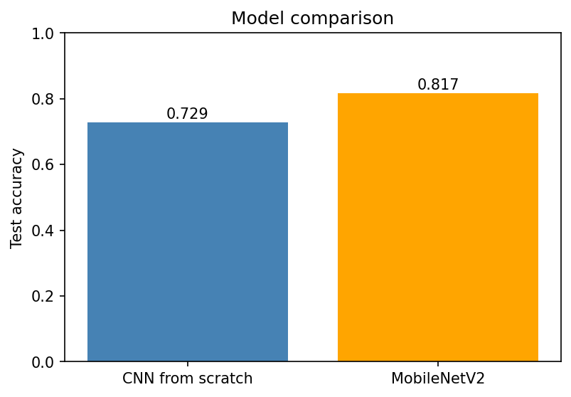
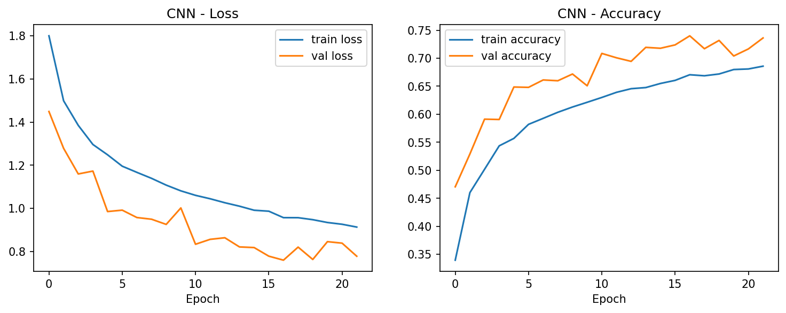
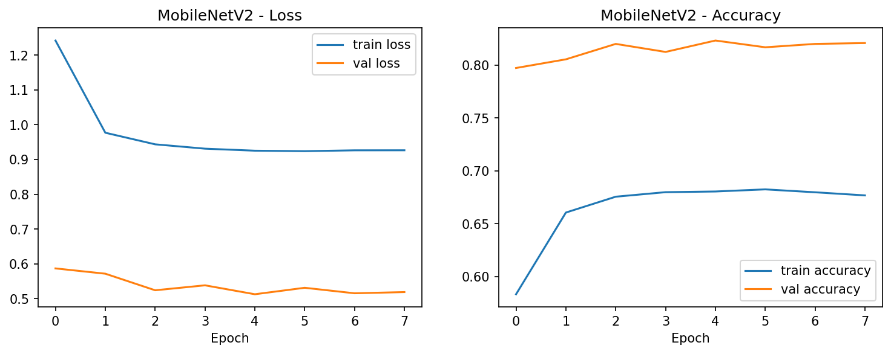
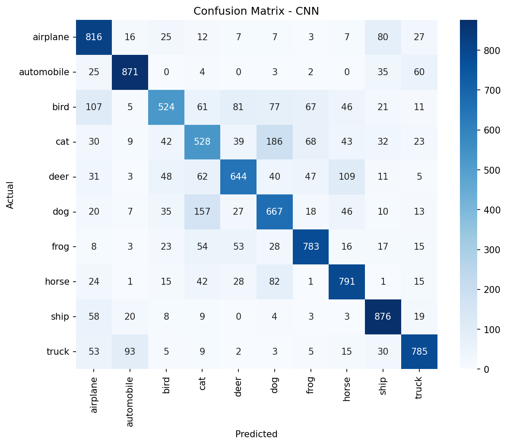

# Project 11: Image Classification with a CNN (CIFAR-10)

A deep learning project where a computer learns to look at a small picture and say what it shows: an airplane, a cat, a ship, and so on.

I built two models and compared them:

1. **A CNN built from scratch**: 72.85% test accuracy
2. **MobileNetV2 with transfer learning**: 81.71% test accuracy

---

## Quick summary

| | |
|---|---|
| **Goal** | Classify images into 10 categories |
| **Dataset** | CIFAR-10 (60,000 images) |
| **Models** | CNN from scratch, MobileNetV2 (transfer learning) |
| **Best result** | 81.71% test accuracy (MobileNetV2) |
| **Tools** | Python, TensorFlow/Keras, NumPy, Matplotlib, Seaborn, scikit-learn |
| **Where I ran it** | Google Colab (free T4 GPU) |

---

## What is this project about?

Computers don't "see" pictures the way we do. They see grids of numbers. A **CNN (Convolutional Neural Network)** is a type of model that is good at finding patterns in those numbers, such as edges, shapes and textures, and using them to decide what is in the picture.

In this project I:
- trained a CNN from zero, so it had to learn everything itself
- then reused **MobileNetV2**, a model that already learned from millions of images, and only taught it the 10 CIFAR-10 classes (this is called **transfer learning**)
- compared the two to see which one works better

---

## The dataset: CIFAR-10

- 60,000 colour images, each only **32 x 32 pixels** (very small!)
- **10 classes:** airplane, automobile, bird, cat, deer, dog, frog, horse, ship, truck
- **50,000** images for training and **10,000** for testing
- The classes are perfectly balanced: 5,000 training images per class

The dataset downloads automatically when you run the notebook, so you don't need to download anything yourself.



---

## Project structure

```
project-11-cifar10-cnn/
├── README.md                      <- you are here
├── requirements.txt               <- the Python libraries needed
├── .gitignore
├── notebooks/
│   └── cifar10_cnn_classification.ipynb   <- all the code and outputs
├── models/
│   └── cifar10_mobilenetv2.keras          <- the saved trained model
└── images/                        <- charts and results used in this README
```

---

## How to run it

### Option 1: Google Colab (easiest, recommended)

No installation needed.

1. Go to [colab.research.google.com](https://colab.research.google.com) and sign in.
2. Click **File → Upload notebook** and choose `notebooks/cifar10_cnn_classification.ipynb`.
3. Turn on the GPU: **Runtime → Change runtime type → T4 GPU → Save**.
4. Click **Runtime → Run all**.
5. Wait about 10 to 20 minutes. Keep the tab open and don't let your laptop sleep.

### Option 2: On your own computer

You need Python 3.9 to 3.12.

```bash
# 1. Download the assignment repo
git clone https://github.com/nirveek10/Data_Science_ML_assignment.git
cd "Data_Science_ML_assignment/11. Image_Classification"

# 2. Install the libraries
pip install -r requirements.txt

# 3. Open the notebook
jupyter notebook notebooks/cifar10_cnn_classification.ipynb
```

Training is much slower without a GPU, so Colab is easier. The notebook creates `images/` and `models/` folders in the folder it runs from.

---

## What I did, step by step

| Step | What happened | Why |
|---|---|---|
| 1. Load data | Loaded CIFAR-10 and looked at sample images | To understand what the model will see |
| 2. Check classes | Counted images per class | To make sure no class is under-represented |
| 3. Normalize | Divided pixel values by 255 (0-255 becomes 0-1) | Small numbers help the model learn faster and more steadily |
| 4. Augment | Random flips, rotations and zooms | Gives the model more variety so it doesn't just memorize |
| 5. Build the CNN | 3 Conv + MaxPooling blocks, then Dense and Dropout | The model that learns from scratch |
| 6. Train | Up to 30 epochs with EarlyStopping | EarlyStopping stops training when it stops improving |
| 7. Evaluate | Accuracy, classification report, confusion matrix | To see how good the model is and where it fails |
| 8. Transfer learning | MobileNetV2 with frozen base, images resized to 96x96 | To reuse knowledge from a model trained on millions of images |
| 9. Compare | Compared both models on the same test set | To pick the best one |

### The CNN in plain words

```
Image → [Conv + MaxPool] x 3 → Flatten → Dense → Dropout → 10 outputs
```

- **Conv layer:** scans the image for patterns (edges, corners, textures)
- **MaxPooling:** shrinks the image and keeps the strongest signals
- **Flatten:** turns the result into one long list of numbers
- **Dense layer:** combines everything to make a decision
- **Dropout:** randomly switches off some neurons during training so the model doesn't memorize the training data
- **Output layer:** 10 numbers, one probability per class

---

## Results

| Model | Test accuracy |
|---|---|
| CNN from scratch | **72.85%** |
| MobileNetV2 (transfer learning) | **81.71%** |



### CNN training curves



The CNN trained for 22 epochs before EarlyStopping ended it, and it kept the best version.

### MobileNetV2 training curves



MobileNetV2 reached its best validation loss at epoch 5 and stopped at epoch 8.

### Which classes were easy and hard? (CNN)

| Easiest (F1 score) | Hardest (F1 score) |
|---|---|
| automobile (0.86) | cat (0.54) |
| ship (0.83) | bird (0.61) |
| truck (0.80) | dog (0.64) |



---

## Key insights

1. **Transfer learning won** by about 9 points (81.71% vs 72.85%). MobileNetV2 had already learned general features like edges and textures, so it didn't have to start from zero.
2. **Vehicles were easier than animals.** Automobile, ship and truck have distinctive shapes. Cats, dogs and birds look more alike, especially at 32x32 pixels.
3. **Birds were often missed.** The CNN's recall for birds was only 0.52, meaning it found about half of the real birds.
4. **Validation accuracy was higher than training accuracy.** This looks strange but is normal here: augmentation and dropout are only active during training, which makes the training images harder than the clean validation images. So the CNN was not overfitting.
5. **MobileNetV2 needed far fewer epochs** to reach its best result than the CNN did.

---

## What I learned

1. I built an image classifier on CIFAR-10, first with a CNN from scratch and then with MobileNetV2.
2. I normalized the pixels and used data augmentation and dropout to reduce overfitting.
3. The CNN scored 72.85% and MobileNetV2 scored 81.71%, so transfer learning gave a clear improvement.
4. Accuracy alone hides which classes are weak, so the classification report and confusion matrix are needed.
5. Next time I would fine-tune the top layers of MobileNetV2 and try a deeper CNN with batch normalization.

---

## Possible improvements

- Fine-tune some of MobileNetV2's top layers instead of keeping the whole base frozen
- Try a deeper CNN with batch normalization
- Train for more epochs
- Try a different pretrained model, such as ResNet50

---

## Glossary for beginners

| Term | Meaning |
|---|---|
| **CNN** | A neural network designed for images |
| **Epoch** | One full pass over the training data |
| **Normalization** | Scaling pixel values to a small range (0 to 1) |
| **Data augmentation** | Randomly changing training images (flip, rotate, zoom) to add variety |
| **Overfitting** | When a model memorizes the training data and does poorly on new data |
| **Dropout** | Randomly switching off neurons during training to reduce overfitting |
| **EarlyStopping** | Stopping training when the model stops improving |
| **Transfer learning** | Reusing a model that was already trained on a large dataset |
| **Frozen layers** | Layers whose learned values are kept fixed during training |
| **Confusion matrix** | A table showing which classes the model mixes up |
| **Precision / Recall / F1** | Scores for how correct (precision) and how complete (recall) the predictions are, with F1 combining the two |

---

## Tools used

Python, TensorFlow / Keras, NumPy, Matplotlib, Seaborn, scikit-learn, Google Colab
