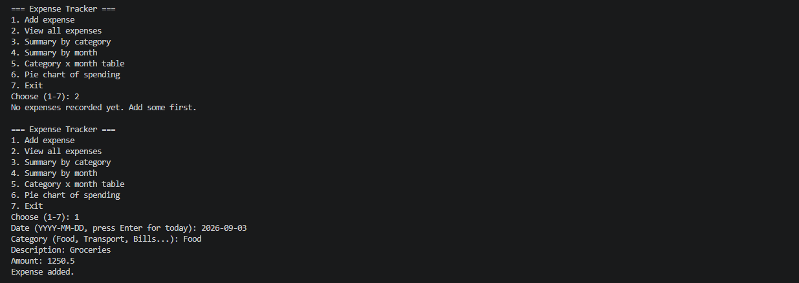
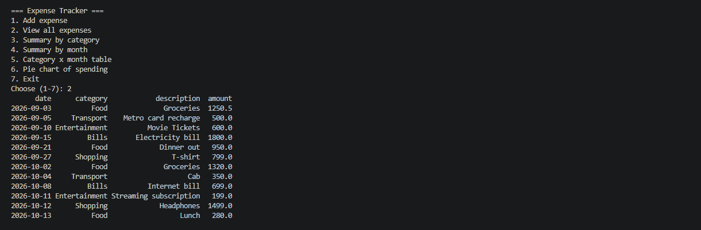
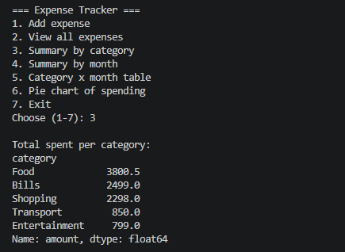
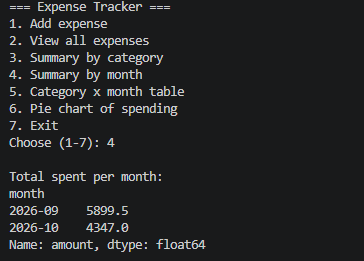
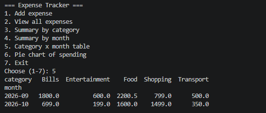
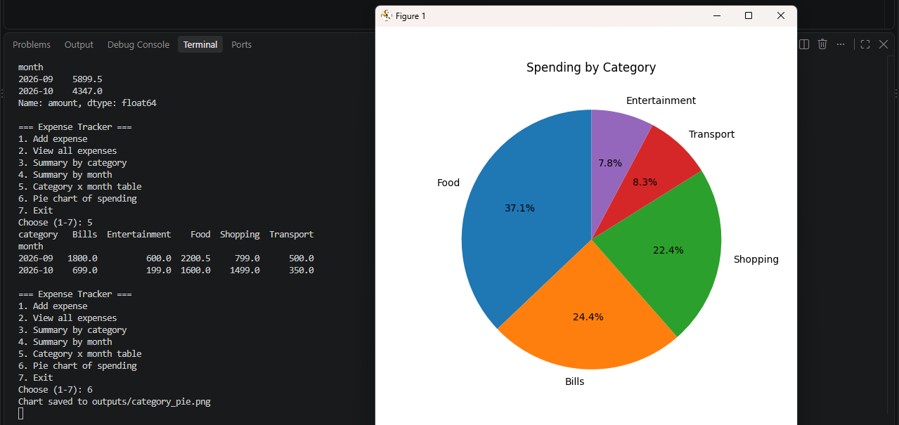

# Expense Tracker with Data Analysis

A command-line app to record daily expenses and summarize them by category and month.
Built with Python OOP, CSV file storage, pandas and matplotlib.

## Features
- Add an expense (date, category, description, amount) with input validation
- View all recorded expenses
- Total spending per category
- Total spending per month
- Category-by-month table
- Pie chart of spending by category (saved as an image)

## Project Structure
```
02-expense-tracker/
├── main.py                    # menu and user input
├── tracker.py                 # Expense and Tracker classes
├── expenses.csv               # saved expenses (sample data included)
├── requirements.txt
├── outputs/
│   └── category_pie.png
├── Screenshots_of_output/
└── README.md
```

## How to Run
1. Install Python 3
2. Install the libraries:
   ```
   pip install -r requirements.txt
   ```
3. Start the program:
   ```
   python main.py
   ```
4. Choose an option from the menu (1-7).

If `expenses.csv` is missing, it is created automatically when the first expense is added.

## How It Works
- `Expense` class: stores one record (date, category, description, amount).
- `Tracker` class: loads expenses from the CSV when it starts, appends new ones to the file, and runs the analysis.
- pandas `groupby()` is used for the category and monthly totals, and `pivot_table()` for the category-by-month table.
- matplotlib draws the pie chart and saves it in the `outputs/` folder.
- Invalid dates, negative amounts and wrong menu choices are handled with `try/except` and loops.

## Output Screenshots

**1. Add expense**


**2. View all expenses**


**3. Summary by category**


**4. Summary by month**


**5. Category x month table**


**6. Pie chart of spending**

